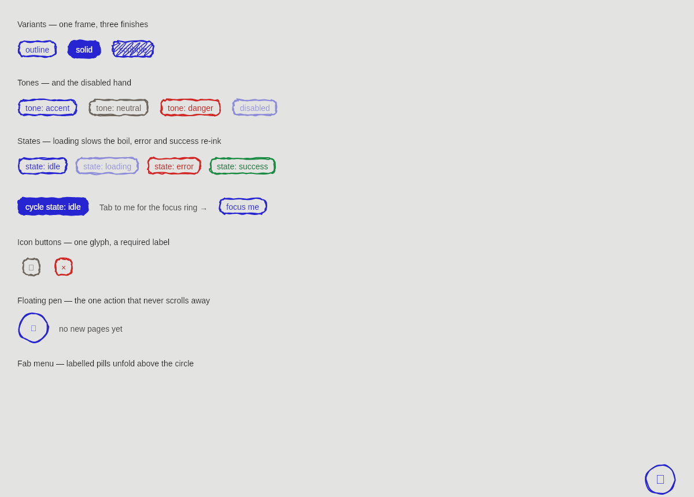
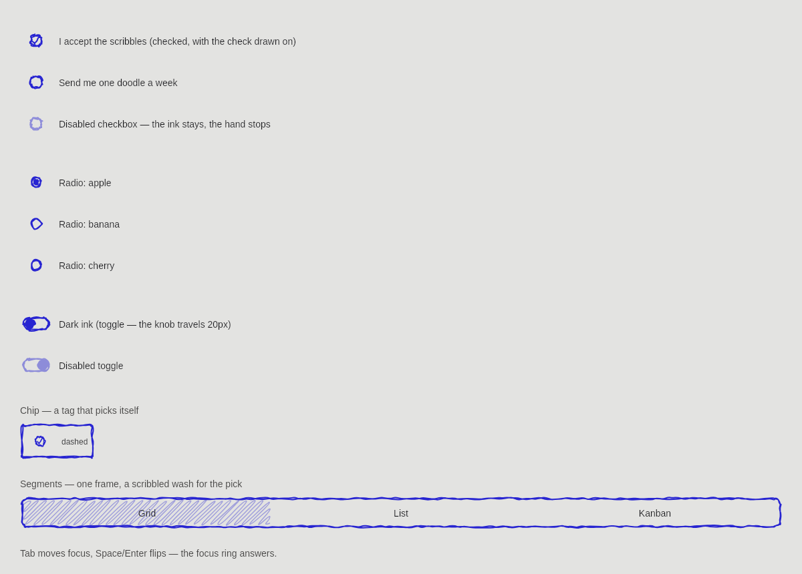
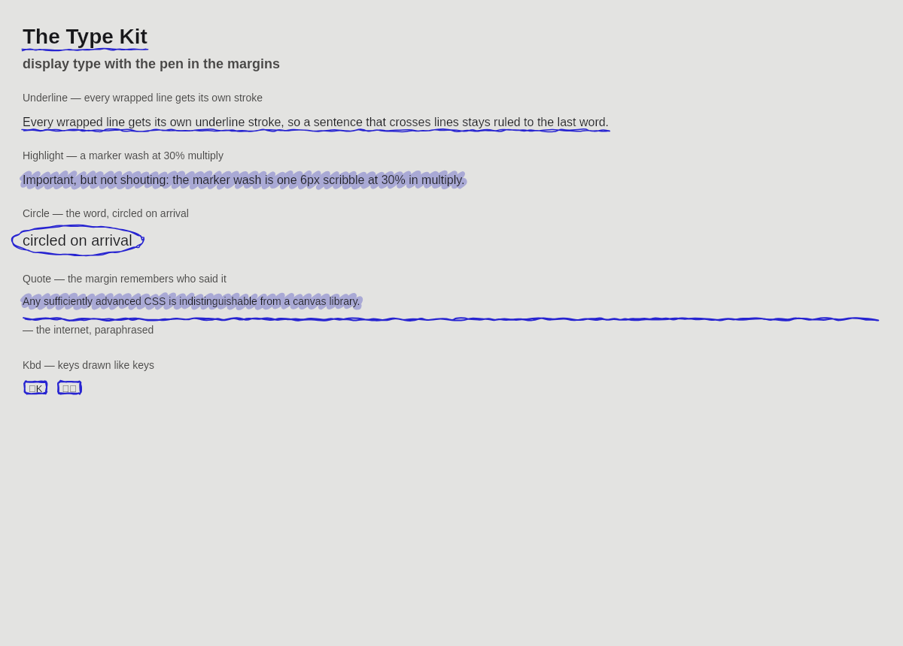
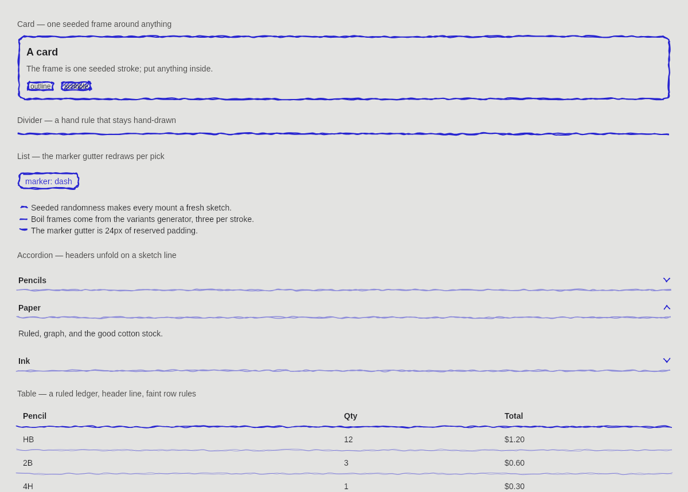
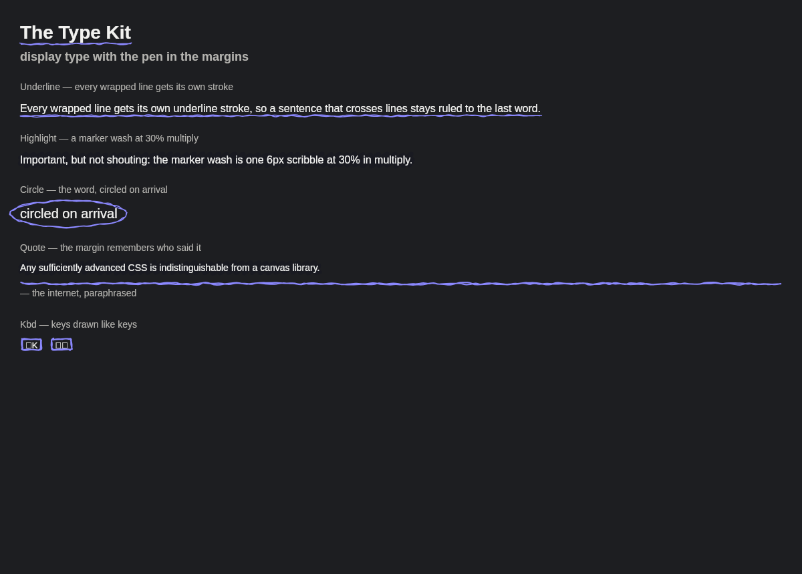
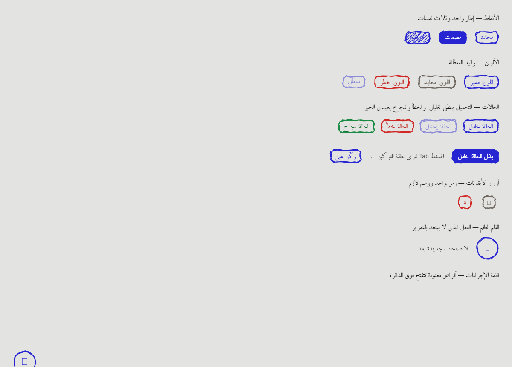

# drawkit

[](https://pub.dev/packages/drawkit)
[](https://pub.dev/packages/drawkit)
[](LICENSE)
[](https://github.com/sandkshnbh/drawkit/actions/workflows/ci.yml)

Animated hand-drawn UI for Flutter. Real widgets on top, seeded pen strokes
behind, one shared boil clock — a Dart port of [drawably](https://github.com/danielwh2/drawably)
with **zero dependencies beyond the Flutter SDK** (no Material, no Cupertino).



## Install

```sh
flutter pub add drawkit
```

Or in `pubspec.yaml`:

```yaml
dependencies:
  drawkit: ^0.1.0
```

## Quick start

Wrap the subtree once with a theme, then drop controls anywhere. The sketch
layer draws itself behind the real widget and never participates in hit
testing.

```dart
import 'package:drawkit/drawkit.dart';
import 'package:flutter/widgets.dart';

void main() => runApp(const Sketchbook());

class Sketchbook extends StatefulWidget {
  const Sketchbook({super.key});

  @override
  State<Sketchbook> createState() => _SketchbookState();
}

class _SketchbookState extends State<Sketchbook> {
  bool _saved = false;

  @override
  Widget build(BuildContext context) {
    return DrawkitTheme(
      data: DrawkitPalette.light.style,
      child: Directionality(
        textDirection: TextDirection.ltr,
        child: DefaultTextStyle(
          style: const TextStyle(
            color: Color(0xFF18181B),
            fontSize: 14,
            height: 1.4,
            decoration: TextDecoration.none,
          ),
          child: ColoredBox(
            color: DrawkitPalette.light.paper,
            child: Center(
              child: Column(
                mainAxisSize: MainAxisSize.min,
                children: [
                  DrawkitButton(
                    onPressed: () => setState(() => _saved = !_saved),
                    child: Text(_saved ? 'saved' : 'save'),
                  ),
                  const SizedBox(height: 16),
                  DrawkitCheckbox(
                    value: _saved,
                    semanticLabel: 'ink saver',
                    onChanged: (v) => setState(() => _saved = v),
                  ),
                ],
              ),
            ),
          ),
        ),
      ),
    );
  }
}
```

Dialogs, sheets, toasts, menus, and the command palette go through the usual
`show*` functions (`showDrawkitDialog`, `showDrawkitSheet`,
`showDrawkitToast`, `showDrawkitCommandPalette`, `showDrawkitDatePicker`).

## Gallery

The `example/` app exercises every widget — hover, press, focus (Tab),
disabled states, live knobs for roughness / boil / seed, a light/dark
palette, and an RTL switch that flips the whole gallery (and its copy) to
Arabic.

| Choices | Type & Ink |
| --- | --- |
|  |  |
| **Cards & Tables** | **Dark palette** |
|  |  |
| **RTL + Arabic copy** | |
|  | |

## How it works

- **The widget does the work, the pen is decoration.** Text fields are real
  `EditableText`s, the select is a real `RawMenuAnchor` menu, checkboxes are
  real focus/semantics-visible toggles. The sketch layer sits behind them and
  never participates in hit testing.
- **One seed, one sketch.** All randomness goes through a bit-exact port of
  the JS `mulberry32`; the same seed draws the same lines, down to the last
  wobble. Golden vectors from the original engine live in
  `test/fixtures/js_vectors.json`.
- **Boil, not frame loops.** Three pre-generated stroke frames swap on a
  shared 1200 ms clock (`variants(seed + i * 7919)`), the Dart equivalent of
  the CSS `step-end` keyframes. Controls with several animated pieces (a
  checkbox outline, its check, its focus ring) share one clock, so frames
  can never sample out of step.
- **Accents, not rebuilds.** Draw-on checks (`trimTo`) and the radio dot /
  toggle knob (`matrix`) are applied at paint time from live animations —
  frames stay cached.
- **Reduced motion respected.** `MediaQuery.disableAnimations` and
  `PlatformDispatcher.accessibilityFeatures.reduceMotion` freeze the boil on
  frame 0 and skip pointer re-sketches.
- **RTL follows the ambient `Directionality`.** Directional geometry
  (`start`/`end`) throughout, and painted anchors re-place themselves: the
  select chevron and menu edge, list gutters and markers, the toggle's
  resting side. LTR drawings are unchanged, stroke for stroke — the gallery
  sidebar has an RTL switch to compare.

## Widgets

| Group | Widgets |
| --- | --- |
| Controls | `DrawkitButton`, `DrawkitCheckbox`, `DrawkitRadio`, `DrawkitToggle`, `DrawkitInput`, `DrawkitTextarea`, `DrawkitSelect` |
| Surfaces | `DrawkitDivider`, `DrawkitCard`, `DrawkitBadge`, `DrawkitList` |
| Text | `DrawkitUnderline`, `DrawkitHighlight`, `DrawkitCircle` |
| Composites | `DrawkitArrow`, `DrawkitChip`, `DrawkitTabs`, `DrawkitTooltip`, `DrawkitAlert`, `DrawkitSteps`, `DrawkitKbd`, `DrawkitQuote`, `DrawkitPager` |
| Actions | `DrawkitSegmentedButton`, `DrawkitSlider`, `DrawkitStepper`, `DrawkitSearchField`, `DrawkitIconButton`, `DrawkitFab`, `DrawkitFabMenu` + `DrawkitFabMenuItem` |
| Feedback | `DrawkitDialog` + `showDrawkitDialog`, `DrawkitSheet` + `showDrawkitSheet`, `DrawkitToast` + `showDrawkitToast` + `DrawkitToastAction`, `DrawkitProgressBar`, `DrawkitSpinner`, `DrawkitSkeleton` |
| Menus | `DrawkitMenu`, `DrawkitMenuItem`, `DrawkitPopover`, `DrawkitAccordion`, `showDrawkitCommandPalette`, `DrawkitDatePicker` + `showDrawkitDatePicker` |
| Structure | `DrawkitAppBar`, `DrawkitNavRail` + `DrawkitNavDestination`, `DrawkitBottomNav`, `DrawkitFloatingNavBar`, `DrawkitBreadcrumb`, `DrawkitTable`, `DrawkitPanel` |
| Content | `DrawkitHeading`, `DrawkitAvatar` + `DrawkitAvatarGroup`, `DrawkitFigure`, `DrawkitRating`, `DrawkitDoodle`, `DrawkitMarquee` |
| States | `DrawkitEmpty`, `DrawkitRefresh` (`DrawkitInput`/`DrawkitTextarea` take `error` + `helper`) |
| Motion | `DrawkitSketchIn`, `DrawkitStagger`, `DrawkitShake` |

## Theming

Theming runs through `DrawkitTheme` + `DrawkitStyle` (`seed`, `roughness`,
`boil`, `strokeColor`, `fillColor`, `width`, `ink`, `palette`); brand
defaults match the CSS custom properties. `DrawkitPalette` ships a light and
a dark preset — `DrawkitTheme(data: DrawkitPalette.dark.style, child: ...)`
re-inks every control, and `drawkitReadableInk` follows the paper: darker on
light, lighter on dark.

```dart
DrawkitTheme(
  data: DrawkitPalette.dark.style.copyWith(roughness: 1.6, seed: 7),
  child: content,
)
```

The optional **DrawkitPen** typeface ships with the package — nothing loads
it unless a style asks for `fontFamily: 'DrawkitPen'`.

## Accessibility

Every control meets the accessibility guidelines: touch boxes are at least
48×48 (`DrawkitTapTarget`, `drawkitMinTapTarget`), tappable nodes carry
labels and `onTap`, tone/state labels pass WCAG contrast on the paper
(`drawkitReadableInk`, `drawkitContrast`), and reduced motion is honoured
throughout. `test/a11y_test.dart` and the gallery-wide
`example/test/a11y_gallery_test.dart` keep it that way.

## Try the gallery

```sh
cd example
flutter run -d chrome
```

## Development

```sh
dart analyze
flutter test
(cd example && flutter test && flutter build web)
```

If your checkout path contains non-ASCII characters, `flutter analyze` can
crash on an LSP JSON error; use `dart analyze`, which is what CI runs.

## License

MIT. Ported from drawably (MIT) — see [LICENSE](LICENSE) for the full
attribution note, and [CHANGELOG.md](CHANGELOG.md) for release history.
